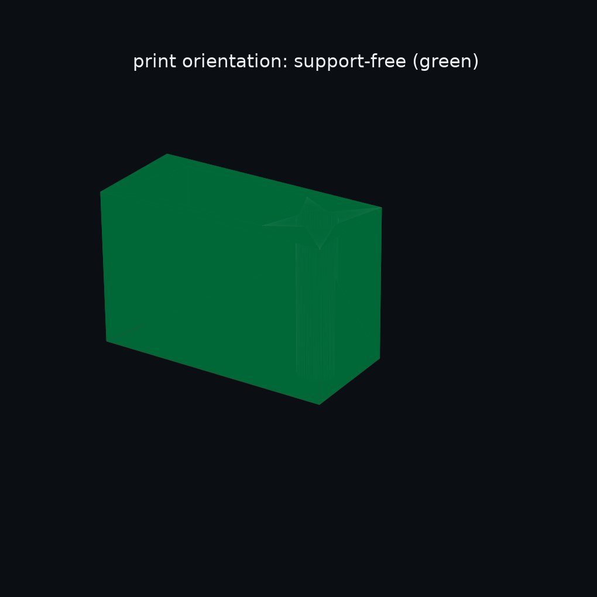
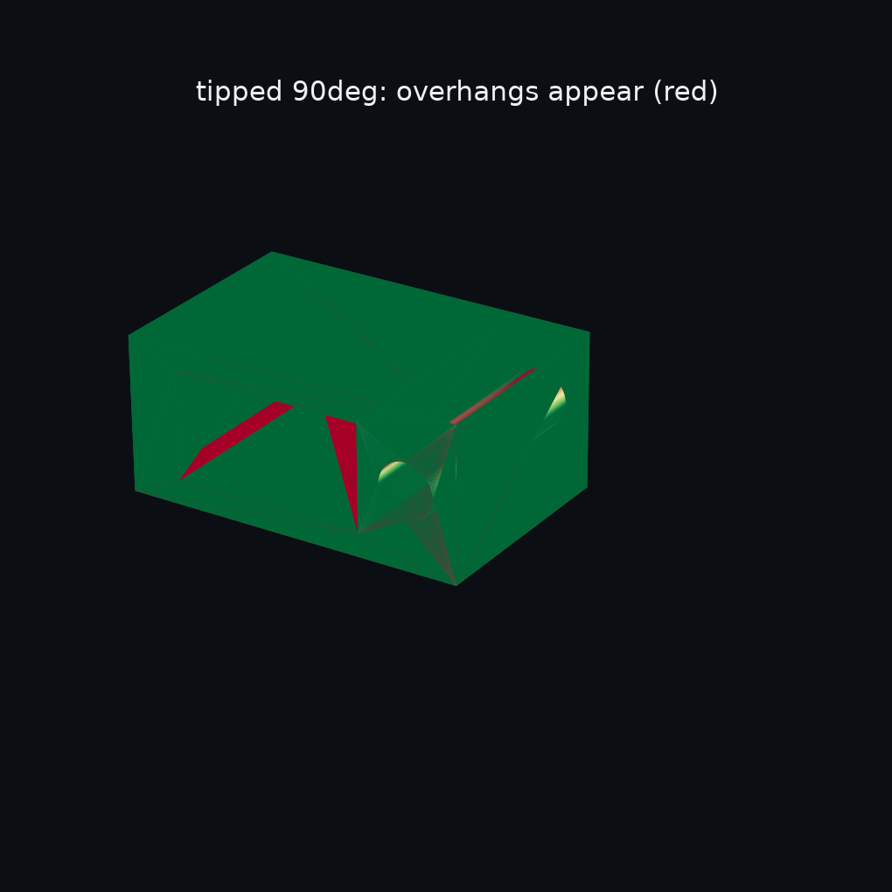
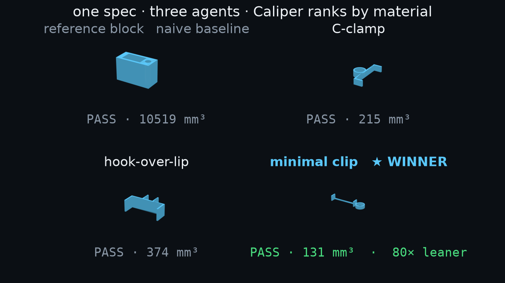
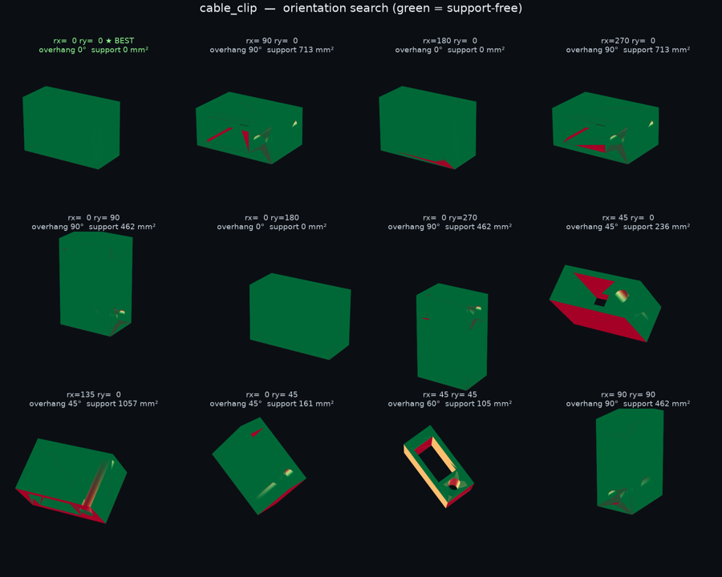

# Partsmith

**Agents that forge parts that fit.** Describe a part in plain language; Claude Code agents write
[build123d](https://github.com/gumyr/build123d) to make it — and it **only ships once it clears
Caliper's printability checks.** Verification isn't an afterthought: it's the **optimization target** the agents design
against, which turns generative CAD from a dice-roll into an engineering loop.

> Generating a mesh is easy. Generating one that **provably fits and passes the support-free check** is
> the hard part. So Partsmith makes "will it print, and will it fit?" checkable — measured, not eyeballed.

Built **entirely during the RAISE Summit Hackathon 2026** (Cursor track), clean-room. 🇫🇷

<p align="center">
  
  &nbsp;
  
</p>
<p align="center"><sub><b>Caliper's overhang analysis, rendered.</b> Green prints support-free; tipped, the downward faces glow red. Measured, not eyeballed.</sub></p>

**[▶ 60-second demo](artifacts/partsmith_demo.mp4) · project site: [`docs/index.html`](docs/index.html) · [how it works ↓](#the-loop)**

## The family

Partsmith is a small platform, not a monolith:

- **Partsmith Caliper** — the verification engine (this repo's core, package [`caliper/`](caliper)).
  It measures real geometry and *gates* every part: overhang, wall thickness, real-world fit — the
  numbers, not vibes. It's the reason you can trust the output, and the objective the agents optimize
  toward. Named for the instrument you'd actually check a printed part with.
- **Partsmith Tricks** *(roadmap)* — a certified library of design tricks (support-free teardrops,
  snap-off support bridges) the agents draw from, each admissible only when it ships the Caliper
  assertion that *proves* it. Tested knowledge, not retrieved.

More `Partsmith X` tools slot under the same umbrella.

---

## The loop

```
 "a clip for a 6 mm cable on a 22 mm shelf lip, support-free"
                      │
       Partsmith ──── ▼
        ┌─────────  spec → objective  ─────────┐
        │  parse into a PartSpec + the checks   │
        │  Caliper will measure against         │
        └───────────────────┬──────────────────┘
                            ▼
      ┌──────  agents forge candidates  ────────┐
      │  Claude Code agents write build123d      │
      └───────────────────┬──────────────────────┘
                          ▼
      ┌────────  Caliper — the gate  ────────────┐
      │  MEASURE real geometry, judge the suite:  │
      │  overhang ≤ 45° · min-wall ≥ 0.8 mm ·     │
      │  real 22 mm shelf + 6 mm cable fit ·      │
      │  fits the plate → pass/fail + a score     │
      └───────────────────┬──────────────────────┘
                 red │            │ green
                     ▼            ▼
             repair to green   ship: part + passport
```

The checks are the **loss function**. The agents are the **search operators**. Partsmith is the
**optimizer**; Caliper is the **judge**. That's why it's not a toy.

## Why it is *not* …

- **… a mesh generator.** The output is verified against numbers, not vibes.
- **… a dashboard.** The engine (Caliper measure + gate + the optimizer) is the product; any UI is a lens.
- **… RAG.** Partsmith Tricks is admissible only when each trick *ships the assertion that proves it* —
  knowledge that's tested, not retrieved.

## Caliper — the gate (sample)

```python
def check(part, spec):                              # every number MEASURED from real geometry
    assert bbox_fits(part, spec.max_bbox_mm)        # fits the build plate
    assert max_overhang_deg(part) <= 45             # prints support-free
    assert min_wall_mm(part)      >= spec.min_wall  # printable walls
    assert 0.15 <= shelf_clearance(part) <= 0.6     # grips the *real* 22 mm shelf
    assert cable_clearance(part)  >= 0.2            # the *real* 6 mm cable fits
```

Exact B-rep distance (OpenCascade), tessellated-mesh ray-casting, face-normal overhang — each check
run against a **real-world probe**: a solid sized from the *nominal* interface (a 22 mm shelf, a 6 mm
cable), placed at the part's declared feature location. A too-tight slot *fails*. *(Full methodology &
honest limitations — including what the probe frame does and doesn't anchor — in the
[appendix](#methodology--limitations).)*

### The gate bites

A verifier is only worth something if it **rejects**. `python -m demo.adversarial` — four
plausible-looking clips, each with one hidden defect:

```text
defect                                     verdict  caught by            value
wall too thin — bore crowds the edge       REJECT   min_wall_mm          0.160
slot too tight — 22 mm shelf won't fit     REJECT   shelf_clearance_mm   0.000
bore too small — 6 mm cable won't fit      REJECT   cable_clearance_mm   0.050
too big for the build plate                REJECT   bbox_x               70.000
```

Each defect is caught by its specific check, with the measured number — before a printer runs. That's
what makes a green result mean something.

## The agentic race

Give the same spec to three independent Claude Code agents and they forge it three different ways.
Caliper judges them all — `python -m demo.race`:

| design | verdict | material | vs. naive block |
|---|:--:|---:|---:|
| **minimal** — twin-wall + collar ★ | ✅ PASS | **131 mm³** | **80× leaner** |
| C-clamp — lateral grip | ✅ PASS | 215 mm³ | 49× |
| hook-over-lip | ✅ PASS | 374 mm³ | 28× |
| reference block (naive) | ✅ PASS | 10 519 mm³ | 1× |

<p align="center"></p>

Same seven checks green on every one — Caliper just ranks by material. Along the way it caught the
minimal design's collar feathering to a **0.013 mm wall** (min-wall fail); the agent fixed it with a
closed ring (`demo/min_wall_convergence.py` shows the final wall stable across 400→20 000 samples).
The checks bite, and the agent responds. Each design is a `parts/*.py` module exposing the same
`make / DEFAULT / probes` contract, so Caliper never knows which part it's judging.

> **Provenance (honest).** The three designs were authored by three separate Claude Code subagents
> during the build, from the shared brief in [`docs/AGENT_RACE.md`](docs/AGENT_RACE.md) — the repo
> ships the resulting static `parts/*.py` modules and Caliper's ranking, **not** a live
> agent-spawning loop. `demo/run_demo.py`'s optimizer tunes a design's *parameters*
> (`ParametricGenerator`); wiring a Claude Code agent as the in-loop generator (`AgentGenerator`, a
> documented hook in `factory/generate.py`) is the next integration, not something this repo claims to
> already do at runtime.

## See it, don't just measure it

A scalar says `max_overhang = 0°`. A picture says *where*. Caliper renders its analysis as fields an
agent's vision encoder reads in one glance — turning a pass/fail number into a spatial redesign cue.

<p align="center"></p>

Twelve orientations scored for support; the agent glances at the sheet and picks the printable pose
(★ = least support). Plus wall-thickness, clearance/interference, and centre-of-mass tip-over maps —
see [`tools/`](tools). *The number stays the gate; the picture is advisory.*

## Run it

```bash
uv venv && uv pip install build123d pytest numpy trimesh rtree matplotlib pillow imageio
source .venv/bin/activate      # then run everything below from the repo root
python -m pytest -q            # Caliper's suite (the objective) on the reference clip
python -m demo.run_demo        # optimize: the score falls while every check stays green
python -m demo.repair_demo     # red → green: a broken clip repaired assertion-by-assertion
python -m demo.race            # the agentic race: 3 agent-forged designs, ranked by Caliper
python -m tools.render artifacts/race/mini_clip.stl   # render any result to PNG + turntable GIF
```

## Status

Built live during the hackathon. **Done:** Partsmith Caliper (7 real checks, part-agnostic), the
optimizer (checks as loss function), red→green auto-repair, and the 3-agent race. **Roadmap:**
Partsmith Tricks (certified gallery), a snap-fit part type (which makes retention a real check), and
real-print capture.

## Methodology & limitations

Honest about exactly what Caliper measures and what it doesn't — a verification tool that overclaims
is a contradiction.

- **Clearance — exact, but frame-relative.** Minimum solid-to-solid distance via OpenCascade
  `BRepExtrema`. The probe is *sized* from the real-world nominal (22 mm shelf, 6 mm cable), so a
  too-tight slot genuinely fails — but it's *placed* at the part's own declared feature, not in an
  independent world frame, and it measures gap **magnitude** at that pose, not an assembly path. So a
  uniformly translated design still passes, and a slot that *encloses* rather than *admits* the shelf
  reads the same gap. Anchoring interfaces to spec-fixed relative positions is roadmap.
- **Overhang — a per-face normal proxy.** Face-normal angle vs. the build plate, bed faces excluded.
  Answers the support-free question; not a slicer-grade bridging/island analysis.
- **Min-wall — a *sampled* inward ray-cast** on the watertight mesh; stable across 400→20 000 samples
  (`python -m demo.min_wall_convergence` — evidence, not a claim), but a heuristic, not a certified gauge.
- **Watertight / slicable** — the exported STL is verified manifold in the passport.
- **Retention is *not* gated.** A slip-fit guide has no real grip force to measure, and Partsmith
  won't fake one — roadmap behind a snap-fit part.
- **These are geometric printability + fit checks** — the proven first pillar of a physics stack, not
  a claim of physical-function proof. Structural/flow verification (FEA/CFD) is the trajectory.

On the visual fields: **the number is the incorruptible gate; the picture is advisory.** An optimizer
rewarded on "make the image greener" would game the colormap — so the scalar assertion stays the thing
that isn't allowed to lie.

## License

MIT (see `LICENSE`).
